# Дополнительные варианты настройки ВМ

 + [Все лабораторные работы по сетевым протоколам в Linux](../Intro.html)

[:contents:]

Данный раздел содержит все дополнительные способы настройки виртуальных машин, которые могут понадобиться для выполнения лабораторных.

# Импорт образа и создание виртуальных машин

## Настройка через GUI

:round_pushpin: 1. Откройте VirtualBox, выберите пункт «Импортировать образ»:

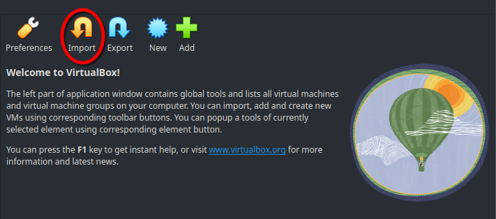

:round_pushpin: 2. Выберите источником образа локальное хранилище данных и укажите путь к установленному `.ova`-файлом.

:round_pushpin: 3. Перейдите к настройкам установки образа (в зависимости от версии VirtualBox настройки будут находиться на следующей странице установщика или в отдельной вкладке `Settings`): Установите галочку в поле «Import hard drives as VDI» и выберите политику MAC-адресов «Generate new MAC addresses for all network adapters». Завершите импортирование.

| 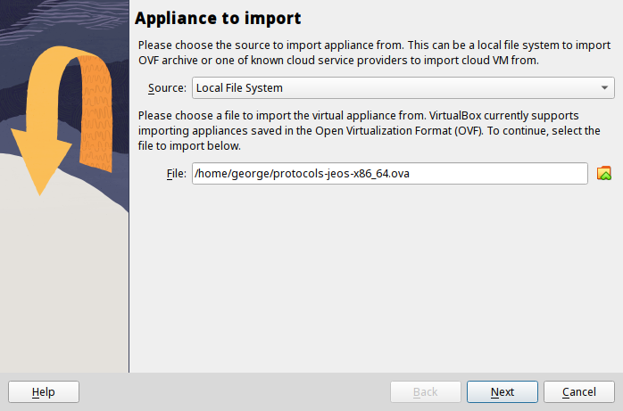 | 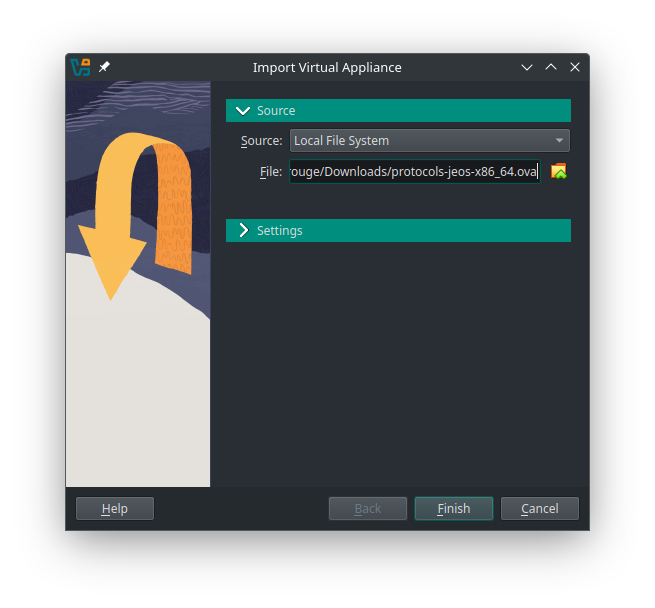 |
| ----------------------------------------- | -------------------------------------------------- |
| 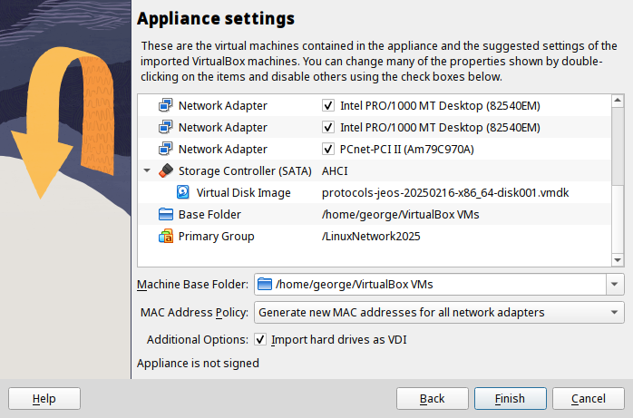 | 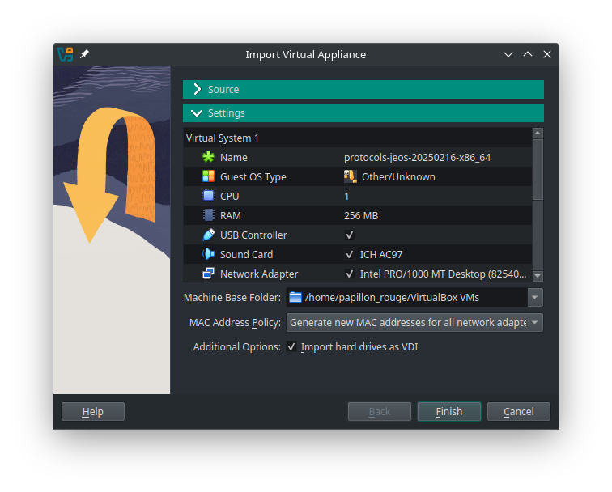 |
|                                           |                                                    |

:information_source: В итоге в VirtualBox должна появиться виртуальная машина с названием вида `protocols-jeos-<date>-x86_64`
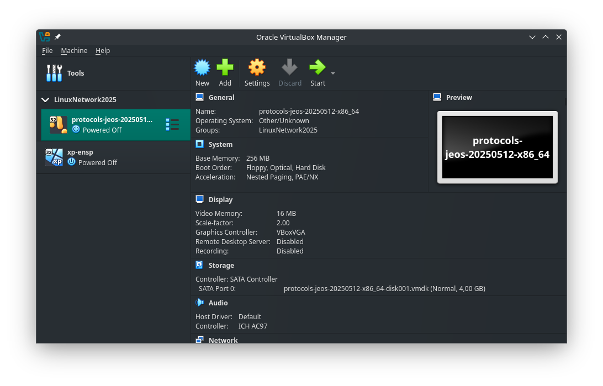
:information_source: Установленная виртуальная машина напрямую не используется для выполнения лабораторных — все действия выполняются на её _связных копиях_ (клон представляет из себя не отдельную машину, а связанный блок изменений основной ВМ и клонированной).

:round_pushpin: 4. Для клонирования машины нажмите ПКМ по основной машине и выберите во всплывающем окне поле «Clone». Окно настроек клонирования также открывается нажатием комбинации клавиш `Ctrl+O`.

:round_pushpin: 5. В настройках клонирования укажите имя создаваемого клона, выберите тип «Связное клонирование» и укажите политику MAC-адресов «Generate new MAC addresses for all network adapters». Завершите клонирование.

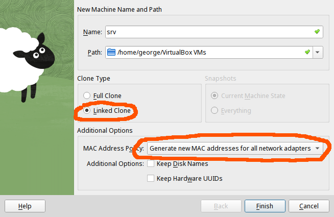


:information_source: Каждая копия наследует данные от основной машины. Для корректной работы клонов требуется перенастраивать значение COM-портов на уникальные для каждого клона.

:round_pushpin: 6. Выберите склонированную машину, перейдите в настройки.

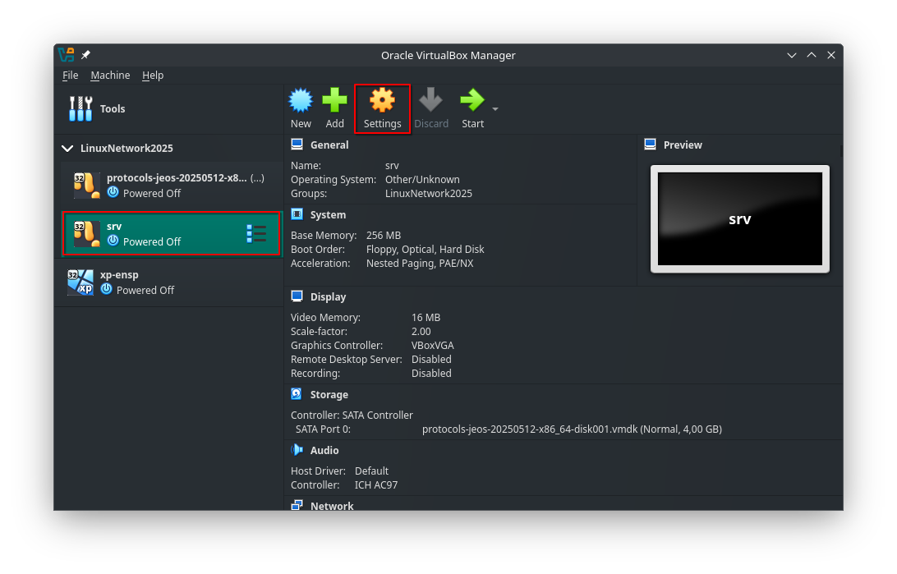

:round_pushpin: 7. В настройках выберите раздел `Serial Ports` и для порта `Port 1` укажите уникальное значение в поле `Path/Address`

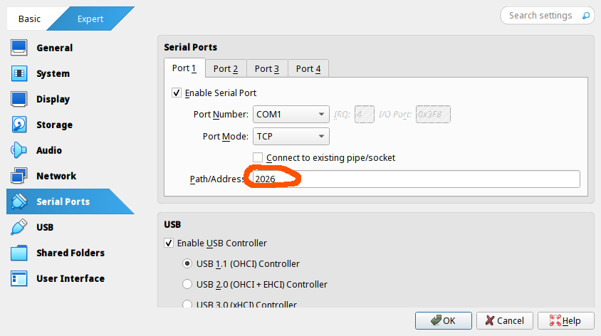

Итогом настройки с помощью VirtualBox будет аналогичное Pysnap состояние.

## Настройка из командной строки

:round_pushpin: 1. Импорт образа диска выполняется командой `VBoxManage import path/to/appliance.ova

```console
[papillon_rouge@localhost ~]$ VBoxManage import Downloads/protocols-jeos-x86_64.ova
0%...10%...20%...30%...40%...50%...60%...70%...80%...90%...100%
Interpreting /home/papillon_rouge/Downloads/protocols-jeos-x86_64.ova...
OK.
<...>
0%...10%...20%...30%...40%...50%...60%...70%...80%...90%...100%
Successfully imported the appliance.
~/papillon_rouge:
```

:round_pushpin: 2. Для клонирования необходимо сохранить снапшот (состояние) основной машины и затем произвести клонирование на его основе.
   + Для создания снапшота используется команда `VBoxManage snapshot protocols-jeos-<date>-x86_64 take SNAPSHOT_NAME`.
   + Для клонирования виртуальной машины используется команда `VBoxManage clonevm protocols-jeos-<date>-x86_64 --groups=/LinuxNetwork2026 --name=CLONE_NAME --options=Link --snapshot=SNAPSHOT_NAME --register`

```console
[papillon_rouge@localhost ~]$ VBoxManage snapshot protocols-jeos-20250216-x86_64 take srv_snapshot
0%...10%...20%...30%...40%...50%...60%...70%...80%...90%...100%
Snapshot taken. UUID: 3e6c0a9a-b9a8-44e6-92de-e96cd9db3790

[papillon_rouge@localhost ~]$ VBoxManage clonevm protocols-jeos-20250216-x86_64 --groups=/LinuxNetwork2025 --name=srv --options=Link --snapshot=srv_snapshot --register
0%...10%...20%...30%...40%...50%...60%...70%...80%...90%...100%
Machine has been successfully cloned as "srv"
```

:warning:  В Windows при ошибке `Invalid machine group` дописать дополнительный backslash к группе: `--groups=//LinuxNetwork2026`

:round_pushpin: 3. Для настройки `COM`-порта клона используется команда `VBoxManage modifyvm CLONE_NAME --uartmode1 tcpserver 2026`

```console
[papillon_rouge@localhost ~]$ VBoxManage modifyvm srv --uartmode1 tcpserver 2026
```

Итогом настройки с помощью командной строки будет аналогичное интерфейсному способу состояние.

---

# Подключение к виртуальным машинам

Для решения проблемы на Linux также возможно использовать Shell-сценарий [vbconnect](Attached_materials/vbconnect), который автоматически производит включение и подключение к виртуальной машине через командную строку. Для запуска необходимо выдать сценарию права на выполнение (`chmod +x vbconnect`) и запустить его с указанием имени запускаемой виртуальной машины (`./vbconnect <NAME>`)


## Windows: подключение через Putty

Для Windows необходимо установить и настроить специальный инструмент [Putty](Attached_materials/putty.exe).

Проведём настройку первого подключения к виртуальной машине с помощью Putty.

:round_pushpin: 1. Для подключения необходимо запустить виртуальную машину в специальном headless-режиме — машина запустится, но встроенный эмулятор экрана включен не будет:

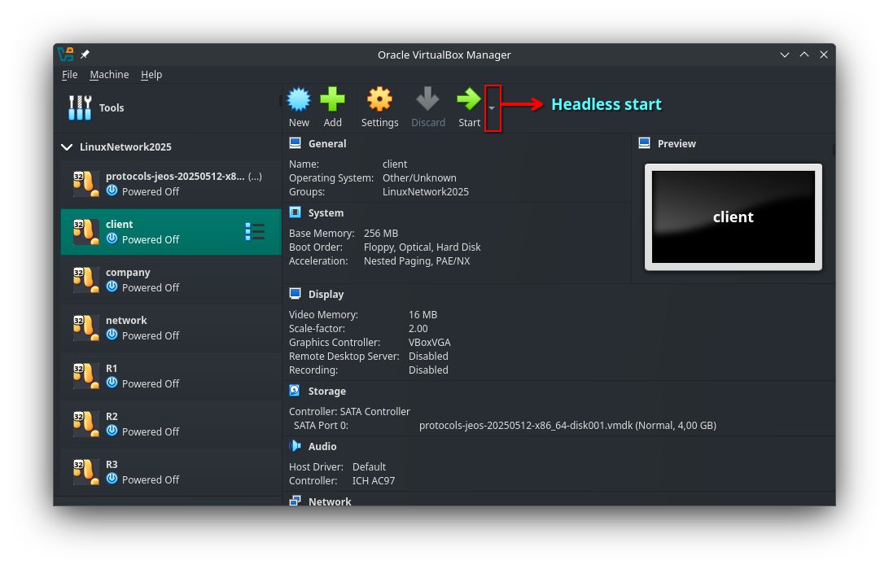

:round_pushpin: 2. Запустим Putty и начнём настройку:
  + На вкладке `Session` необходимо указать параметры подключения:
	1. Имя хоста (всегда `localhost`, поскольку все виртуальные машины находятся на нашем устройстве)
	2. Порт подключения (указанный в настройках виртуальной машины в поле `Serial Ports → Port 1 → Path/Address`)
	3. Тип соединения (TCP Raw для чистой передачи информации между виртуальной машиной и нашей системой)
	4. Закрытие окна по завершении подключения

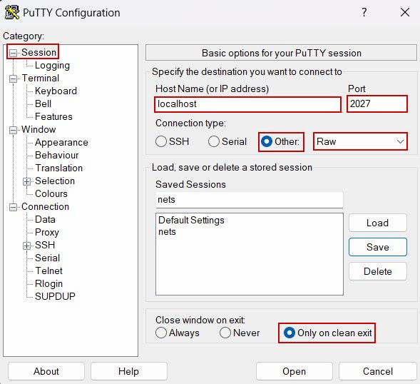

 + На вкладке `Terminal` необходимо указать параметры терминала:
	1. Отключение дублирования ввода-вывода и локального редактирования командной строки
	2. Не забудьте применить изменения (Apply)

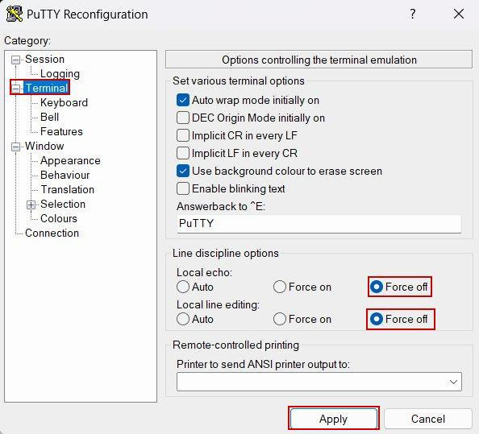

 + На вкладке `Terminal → Features` необходимо указать особенности терминала:

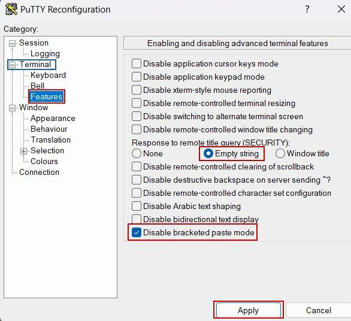

 + На вкладке `Window → Selection` необходимо указать настройки работы с буфером обмена:
	1. Работа с помощью мыши (Выделение интересуемого элемента копирует элемент)
	2. Работа с помощью комбинации клавиш (`Ctrl+Shift+C` копирует выделенный элемент, `Ctrl+Shift+V` вставляет элемент)
	3. Не забудьте применить изменения (Apply)


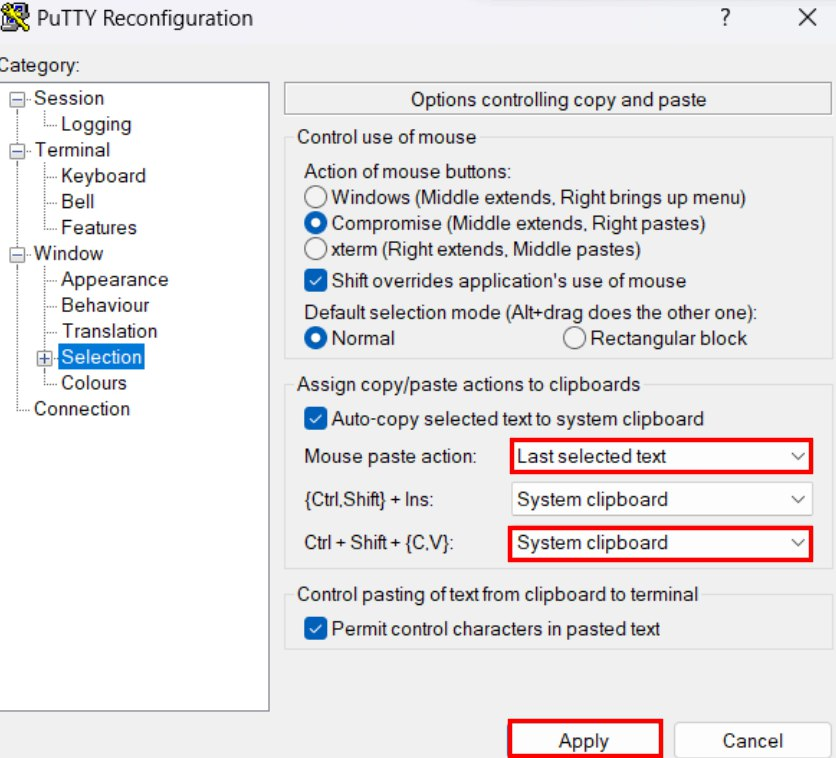

:round_pushpin: 3. Вернёмся на вкладку `Session`, сохраним внесённые изменения: в поле `Saved Sessions` впишем _любое_ название и сохраним настройки.

:information_source: В будущем при подключении других виртуальных машин достаточно будет выбрать соответствующую сохранённую сессию, загрузить её (`Load`), указать правильный порт и запуститься.

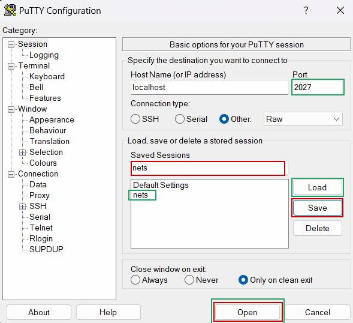

---

# Создание COM-соединения

:round_pushpin: 1. Создайте два клона с именами first и second.

:round_pushpin: 2. В настройках виртуальных машин в графической оболочке VirtualBox подключите соединение на COM-порт 2:
 + Для одного устройства укажите настройку создания канала (убрать галочку);
 + Для второго устройства укажите только подключение к нему (оставить галочку).

:warning:  В случае Windows название порта (поле `Port/Address`) имеет более сложную структуру: `\\.\pipe\<pipe_name>`


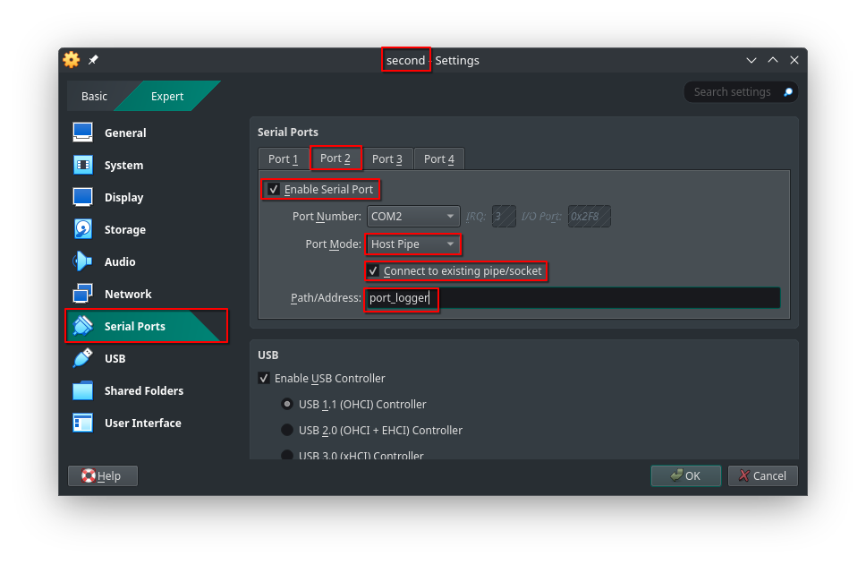

---

# Настройка Eth-соединения

:round_pushpin: 1. В настройках виртуальных машин в графической оболочке VirtualBox в разделе «Network» на Adapter 2 выберите пункт «Internal Network» и укажите имя для новой сети.

:information_source: При указании у разных виртуальных машин одной и той же сети они автоматически соединяются через виртуальную ethernet-сеть и могут взаимодействовать в рамках этой сети (данное соединение аналогично соединению машин через коммутатор).


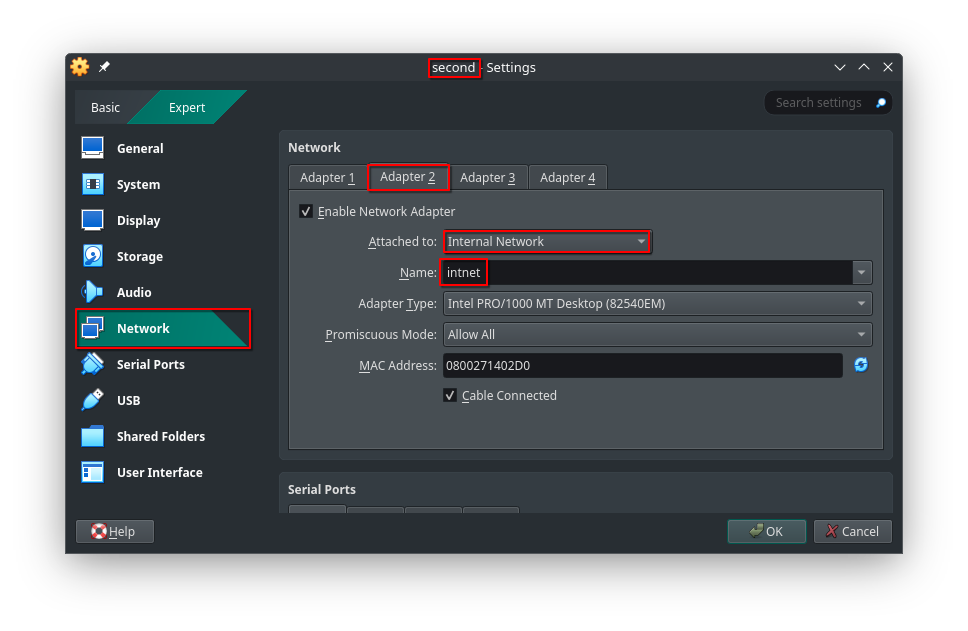

:information_source: Заметьте, что автоматически для разных виртуальных машин сгенерировались разные MAC-адреса.


---

# Извлечение отчета из ВМ

:warning: ***ВАЖНО:*** настройка порта для передачи данных может быть проведена ещё _при стартовой настройке виртуальных машин_, но в таком случае выводы некоторых команд могут сильнее отличаться от показанных в лабораторных.

Поскольку настройка проводится над виртуальными машинами, для её проведения необходимо выключить машины, используя команду `poweroff`

:round_pushpin: 1. Выключите машины с помощью команды `poweroff` или передачей сигнала о завершении работы из VirtualBox

:warning: ***ВАЖНО:*** Не выключайте машины «отключением питания» (пункт «power off the machine» при выключении через VirtualBox) во избежание ошибок в сохранении данных.

```console
[root@first ~]# poweroff
------------------------------------------
[root@second ~]# poweroff
```

:information_source: Для передачи используется последовательный порт (COM-порт), настраиваемый на запись в файл (Port Mode: Raw File), в качестве названия выводимого файла необходимо указать соответствующее имя файла `report.<#Lab>.<hostname>`

\*Имена файлов внутри ВМ и в основной системе, вообще говоря, не обязаны быть одинаковыми. Но для удобства проверки мы просим использовать те же имена.

:round_pushpin: 2. Настройте на устройствах COM-порты для передачи данных из виртуальных машин

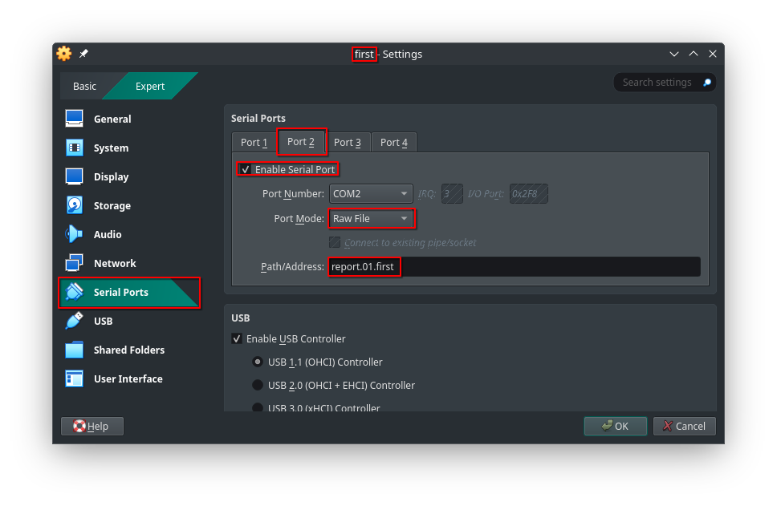


:round_pushpin: 3. Вновь запустите виртуальные машины.

:information_source: Для передачи данных аналогично работе с виртуальными каналами необходимо настроить порты для передачи, после чего передать на них файлы-отчёты. По итогу, команды для передачи всегда будут одинаковыми (не забывайте пользоваться автодополнением через `Tab` для записи длинных команд):
 + `stty raw -echo < /dev/ttyS1`
 + `cat report.<#Lab>.<hostname> > /dev/ttyS1`

:round_pushpin: 4. С помощью описанных выше команд перешлите файлы отчётов с виртуальных машин в вашу систему

`@first`
```console
[root@first ~]# ls
bin  report.01.first  tmp
[root@first ~]# stty raw -echo < /dev/ttyS1
[root@first ~]# cat report.01.first > /dev/ttyS1
[root@first ~]# poweroff
```

`@second`
```console
[root@second ~]# ls
bin  report.01.second  tmp
[root@second ~]# stty raw -echo < /dev/ttyS1
[root@second ~]# cat report.01.second > /dev/ttyS1
[root@second ~]# poweroff
```

После этого в вашей системе появятся соответствующие файлы. Для проверки корректности убедитесь, что полученные файлы _ненулевого_ объёма (в среднем, несколько килобайт). В случае использования собственной системы `Linux`, можно установить утилиту report из [репозитория](https://github.com/FrBrGeorge/vbsnap) и проверять корректность записанного файла также прогоном в утилите:

`@user`
```console
[USER@USERsPC] ls | grep report
report.01.first
report.01.second

[USER@USERsPC] report report.01.first
tar: ./CPU.txt: time stamp 2025-10-13 15:25:57 is 8649.335340872 s in the future
tar: ./IN.txt: time stamp 2025-10-13 15:28:02 is 8774.335237496 s in the future
tar: ./BOTH.txt: time stamp 2025-10-13 15:28:02 is 8774.335184105 s in the future
tar: ./TIME.txt: time stamp 2025-10-13 15:28:02 is 8774.335138278 s in the future
tar: ./OUT.txt: time stamp 2025-10-13 15:28:02 is 8774.335085218 s in the future
tar: .: time stamp 2025-10-13 15:25:57 is 8649.334813324 s in the future
Replay report.01.first
[root@01-first ~]# ip a show eth1
3: eth1: <BROADCAST,MULTICAST,UP,LOWER_UP> mtu 1500 qdisc fq_codel state UP group default qlen 1000
   link/ether 08:00:27:da:00:dd brd ff:ff:ff:ff:ff:ff
   altname enp0s8
   altname enx080027da00dd
   inet 10.9.0.1/24 scope global eth1
      valid_lft forever preferred_lft forever
[root@01-first ~]# ping -c5 10.9.0.2
PING 10.9.0.2 (10.9.0.2) 56(84) bytes of data.
64 bytes from 10.9.0.2: icmp_seq=1 ttl=64 time=0.531 ms
64 bytes from 10.9.0.2: icmp_seq=2 ttl=64 time=0.635 ms
64 bytes from 10.9.0.2: icmp_seq=3 ttl=64 time=0.712 ms
64 bytes from 10.9.0.2: icmp_seq=4 ttl=64 time=0.558 ms
64 bytes from 10.9.0.2: icmp_seq=5 ttl=64 time=0.927 ms

--- 10.9.0.2 ping statistics ---
5 packets transmitted, 5 received, 0% packet loss, time 4132ms
rtt min/avg/max/mdev = 0.531/0.672/0.927/0.142 ms
[root@01-first ~]#
exit

Replay report.01.first finished

[USER@USERsPC]
```
